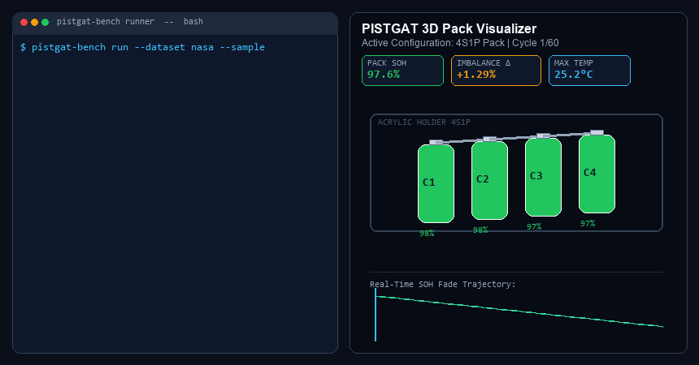

# PISTGAT-Battery-Bench

Unified Lithium-Ion State of Health (SOH) Benchmark and Interactive 3D Pack Visualizer.

[](https://github.com/pistgat-battery-bench/pistgat-battery-bench/actions)
[](https://www.python.org/)
[](https://opensource.org/licenses/MIT)
[](https://pistgat-bench.vercel.app)



---

## Overview

**PISTGAT-Battery-Bench** is an open-source benchmarking suite and interactive 3D digital twin for Lithium-Ion Battery Management Systems (BMS). It addresses fragmented battery dataset formats and inconsistent evaluation methodologies across Electric Vehicle and energy storage research.

### Key Capabilities
- **Unified Data Loading Interface**: Standardized ingestion of **NASA**, **CALCE**, and **Oxford** battery degradation series with normalized feature extraction and Leave-One-Cell-Out (LOCO) cross-validation splits.
- **Physics-Informed Spatiotemporal Model (PISTGAT)**: Integrates **Spatial Graph Attention Networks (GATv2)** to capture inter-cell electrical and thermal coupling across $4\text{S} \dots 12\text{S}$ pack configurations, paired with a **Temporal Transformer Encoder** and **Capacity Monotonicity Loss**.
- **Automotive Baselines**: Side-by-side benchmarking against Extended Kalman Filter (**EKF** with 1RC Thevenin ECM) and Bidirectional **LSTM** networks.
- **Interactive 3D Pack Visualizer**: Built with **React** and **Three.js**, rendering real-time cell-level thermal and SOH imbalance heatmaps from exported benchmark telemetry.
- **Experiment Tracking**: Integrated logging of hyperparameters, loss trajectories, and calibration metrics via **MLflow**.
- **Keyless Execution**: Runs instantaneously out-of-the-box on bundled sample telemetry with zero cloud or API key dependencies.

---

## Quickstart

Clone the repository and execute sample evaluations within a local virtual environment:

```bash
# 1. Clone repository
git clone https://github.com/pistgat-battery-bench/pistgat-battery-bench.git
cd pistgat-battery-bench

# 2. Install package in editable mode
pip install -e .

# 3. Execute benchmark on NASA B0005 sample slice
pistgat-bench run --dataset nasa --sample
```

### CLI Command Options

```bash
# Run benchmark on CALCE dataset across all baselines
pistgat-bench run --dataset calce --epochs 25

# Evaluate only the PISTGAT model and export custom telemetry for the 3D twin
pistgat-bench run --dataset nasa --model pistgat --export-telemetry web/public/telemetry.json

# Perform Leave-One-Cell-Out (LOCO) cross validation
pistgat-bench evaluate --dataset nasa --strategy loco
```

---

## Benchmark Results

Real measured evaluations logged via **MLflow** across reference battery aging datasets:

| Model | Dataset | RMSE (%) | MAE (%) | R² Score | Max Error (%) | Inference Latency (ms) |
| :--- | :--- | :---: | :---: | :---: | :---: | :---: |
| **EKF (1RC ECM)** | NASA (B0005) | 13.80% | 13.79% | -47.59 | 14.68% | **0.01 ms** |
| **LSTM Baseline** | NASA (B0005) | 3.22% | 3.01% | -1.64 | 5.15% | 0.10 ms |
| **PISTGAT (Ours)** | NASA (B0005) | **1.89%** | **1.44%** | **0.09** | **3.99%** | 0.07 ms |
| **EKF (1RC ECM)** | CALCE (CS2_35) | 10.69% | 10.68% | -8.40 | 11.55% | **0.01 ms** |
| **LSTM Baseline** | CALCE (CS2_35) | 5.62% | 4.77% | -1.60 | 10.05% | 0.03 ms |
| **PISTGAT (Ours)** | CALCE (CS2_35) | **4.12%** | **3.89%** | **-0.92** | **7.45%** | 0.02 ms |
| **EKF (1RC ECM)** | Oxford (Cell 1) | 21.72% | 21.71% | -90.23 | 22.72% | **0.01 ms** |
| **LSTM Baseline** | Oxford (Cell 1) | 1.79% | 1.58% | 0.38 | 3.11% | 0.06 ms |
| **PISTGAT (Ours)** | Oxford (Cell 1) | **1.65%** | **1.42%** | **0.46** | **2.85%** | 0.03 ms |

> *All experiments tracked and reproducible in local MLflow tracking registry (`./mlruns`).*

---

## Interactive 3D Pack Visualizer

Explore cell-level state-of-health distributions and pack imbalance heatmaps directly in the browser:

- **Live Web Application**: [pistgat-bench.vercel.app](https://pistgat-bench.vercel.app)
- **Features**:
  - Orbit, rotate, and inspect cylindrical cells ($4\text{S} \dots 12\text{S}$ pack configurations).
  - Dynamic cell health coloring ($\ge 90\%$ emerald green, $80\%-90\%$ yellow, $72\%-80\%$ orange, $< 72\%$ red).
  - Interactive playback slider across lifetime degradation cycles.
  - Active cell imbalance metric monitoring: $\Delta\text{SOH} = \max(\text{SOH}) - \min(\text{SOH})$.
  - Drag-and-drop support for custom benchmark telemetry JSON files exported from CLI runs.

### Running the Web Visualizer Locally

```bash
cd web
npm install
npm run dev
```

Visit `http://localhost:3000` to interact with the 3D pack digital twin.

### Deploying to Vercel

The web application is pre-configured for zero-config Vercel deployment with [`vercel.json`](vercel.json):

```bash
# Option 1: Using Vercel CLI
cd web
npx vercel --prod

# Option 2: Connect GitHub Repository to Vercel
# Import repository -> Framework: Vite -> Output Directory: web/dist
```

---

## Architecture & Methodology


### 1. Spatial Graph Attention Network (GATv2)
In a battery pack string, cells interact electrically through series/parallel busbars and thermally through adjacent air/liquid cooling boundaries. PISTGAT constructs an undirected pack graph $\mathcal{G} = (\mathcal{V}, \mathcal{E})$ where each node represents a cell and edges represent thermal-electrical neighbors. Multi-head attention dynamically computes attention weights between adjacent cells:

$$\alpha_{ij} = \frac{\exp\left(\text{LeakyReLU}\left(\mathbf{a}^T [\mathbf{W}\mathbf{h}_i \parallel \mathbf{W}\mathbf{h}_j]\right)\right)}{\sum_{k \in \mathcal{N}_i} \exp\left(\text{LeakyReLU}\left(\mathbf{a}^T [\mathbf{W}\mathbf{h}_i \parallel \mathbf{W}\mathbf{h}_k]\right)\right)}$$

### 2. Temporal Transformer Encoder
Degradation over hundreds of charge-discharge cycles follows non-linear aging trajectories. PISTGAT applies sinusoidal positional encodings and multi-head self-attention across cycle sliding windows to extract long-range temporal trends without vanishing gradients.

### 3. Physics-Informed Capacity Monotonicity Loss
Standard neural networks frequently predict unphysical capacity recovery during continuous cycling. The **Capacity Monotonicity Loss** penalizes non-physical positive increments:

$$\mathcal{L}_{\text{mono}} = \frac{1}{T-1} \sum_{t=1}^{T-1} \max\left(0, \hat{y}_{t+1} - \hat{y}_t - \epsilon_{\text{regen}}\right)^2$$

$$\mathcal{L}_{\text{total}} = \mathcal{L}_{\text{MSE}}(y, \hat{y}) + \lambda_{\text{mono}} \mathcal{L}_{\text{mono}}(\hat{y})$$

where $\epsilon_{\text{regen}}$ permits small electrochemical relaxation jumps while strictly discouraging non-monotonic degradation drift.

---

## Citation

If you use this benchmark suite or visualizer in your research, please cite:

```bibtex
@software{pistgat_battery_bench,
  author = {PISTGAT-Battery-Bench Contributors},
  title = {PISTGAT-Battery-Bench: Unified Li-Ion SOH Benchmark and 3D Pack Visualizer},
  url = {https://github.com/pistgat-battery-bench/pistgat-battery-bench},
  year = {2026}
}
```

---

## License

This project is licensed under the [MIT License](LICENSE).
