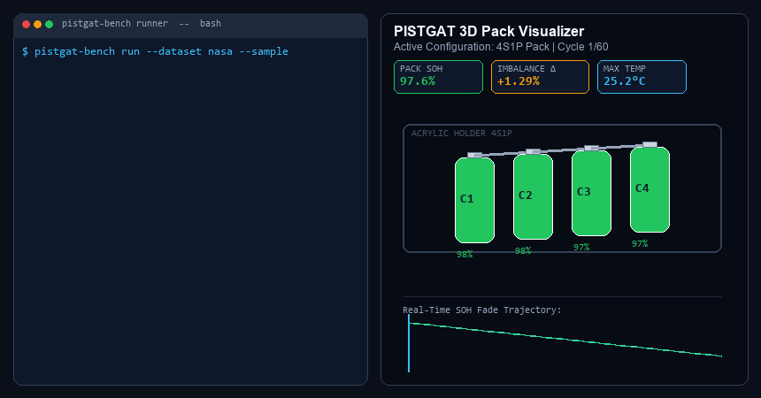

Estimating the **State of Health (SOH)** of Lithium-Ion batteries is one of the most critical challenges across electric vehicles (EVs), grid energy storage, and consumer electronics. A battery pack is not an abstract black-box: it is an interconnected electrochemical system where individual cells age, experience thermal gradients, and drift out of balance.

Yet, if you survey the battery machine learning landscape today, two persistent bottlenecks stand out:

1. **Fragmented Datasets & Baselines**: The most prominent public battery aging datasets—**NASA Ames Prognostics**, University of Maryland **CALCE**, and the **Oxford Battery Degradation Group**—all utilize fundamentally different file formats (`.mat` structures, disparate Excel spreadsheets, raw CSVs), varying cycle definitions, and conflicting feature sets.
2. **Disconnected Visual Diagnostics**: Most ML benchmarks stop at printing test RMSE in a terminal. They fail to reflect pack-level spatial phenomena (e.g. series string cell-imbalance hotspots) or provide intuitive ways to customize and embed the diagnostic twin into custom dashboards.

To bridge battery electrochemistry with modern spatiotemporal deep learning and interactive 3D web graphics, we built and open-sourced **[PISTGAT-Battery-Bench](https://github.com/nishanth24vv/PISTGAT-Battery-Bench)**.

In this deep dive, we'll explore:
- Why purely temporal sequence models (like LSTMs) fail on multi-cell battery packs.
- How **Physics-Informed Spatiotemporal Graph Attention Networks (PISTGAT)** capture inter-cell electrical and thermal coupling.
- Formulating a **Capacity Monotonicity Loss** to prevent unphysical capacity jumps during aging.
- Building a **Customizable 3D Digital Twin** in React and Three.js that developers can style and adapt to their own personal UI choices.

---

## 1. The Challenge: Physics Meets Deep Learning

A typical EV battery module contains dozens of cylindrical (e.g., 18650 or 21700) or prismatic cells connected in series strings ($4\text{S} \dots 12\text{S}+$).


When evaluating battery degradation, purely data-driven models suffer from two major flaws:

### Flaw 1: Spatial Blindness
In a pack, cells age at different rates due to non-uniform thermal dissipation, contact resistance differences, and manufacturing tolerances. A standard recurrent network treats each cell in isolation, ignoring neighboring thermal conduction and electrical series constraints.

### Flaw 2: Non-Physical Capacity Inversions
Battery capacity degradation is governed by irreversible degradation mechanisms: Solid Electrolyte Interphase (SEI) layer growth, active lithium inventory loss, and electrode mechanical cracking. While small recovery jumps can occur during rest periods, standard neural networks frequently predict oscillating, non-physical capacity recoveries (e.g., predicting an unprompted $+5\%$ SOH recovery mid-cycle).

---

## 2. PISTGAT Architecture Breakdown

PISTGAT (**Physics-Informed Spatiotemporal Graph Attention Network with Transformer**) resolves these challenges through a three-stage hybrid architecture.

### Stage 1: Spatial Graph Attention (GATv2)
We model the physical battery pack as an undirected graph $\mathcal{G} = (\mathcal{V}, \mathcal{E})$, where each node represents a cell $v_i \in \mathcal{V}$, and edges $e_{ij} \in \mathcal{E}$ represent electrical series connections and adjacent thermal transfer paths.

Using **GATv2**, the network learns dynamic attention coefficients $\alpha_{ij}$ between adjacent cells:

$$\alpha_{ij} = \frac{\exp\left(\text{LeakyReLU}\left(\mathbf{a}^T [\mathbf{W}\mathbf{h}_i \parallel \mathbf{W}\mathbf{h}_j]\right)\right)}{\sum_{k \in \mathcal{N}_i} \exp\left(\text{LeakyReLU}\left(\mathbf{a}^T [\mathbf{W}\mathbf{h}_i \parallel \mathbf{W}\mathbf{h}_k]\right)\right)}$$

```python
from torch_geometric.nn import GATv2Conv
import torch.nn.functional as F

class PISTGATModel(nn.Module):
    def __init__(self, input_dim=6, model_dim=48, gat_heads=2):
        super().__init__()
        self.gat1 = GATv2Conv(
            in_channels=model_dim,
            out_channels=model_dim // gat_heads,
            heads=gat_heads,
            concat=True
        )
        self.gat2 = GATv2Conv(
            in_channels=model_dim,
            out_channels=model_dim,
            heads=1,
            concat=False
        )
        # Residual spatial fusion
```

### Stage 2: Temporal Transformer Encoder
To capture degradation history across hundreds of operational cycles, each cell node's temporal sequence is processed with sinusoidal positional encodings and multi-head self-attention:

```python
encoder_layer = nn.TransformerEncoderLayer(
    d_model=model_dim,
    nhead=4,
    dim_feedforward=model_dim * 4,
    dropout=0.1,
    activation="gelu",
    batch_first=True
)
self.temporal_transformer = nn.TransformerEncoder(encoder_layer, num_layers=2)
```

### Stage 3: Physics-Informed Capacity Monotonicity Loss
To strictly penalize non-physical capacity recoveries without preventing minor rest relaxation, we designed a custom **Capacity Monotonicity Loss**:

$$\mathcal{L}_{\text{mono}} = \frac{1}{T-1} \sum_{t=1}^{T-1} \max\left(0, \hat{y}_{t+1} - \hat{y}_t - \epsilon_{\text{regen}}\right)^2$$

$$\mathcal{L}_{\text{total}} = \mathcal{L}_{\text{MSE}}(y, \hat{y}) + \lambda_{\text{mono}} \mathcal{L}_{\text{mono}}(\hat{y})$$

```python
class CapacityMonotonicityLoss(nn.Module):
    """Penalizes non-physical capacity recoveries in predicted SOH sequences."""
    def __init__(self, epsilon_regen: float = 0.005, penalty_weight: float = 1.0):
        super().__init__()
        self.epsilon_regen = epsilon_regen
        self.penalty_weight = penalty_weight

    def forward(self, y_pred: torch.Tensor) -> torch.Tensor:
        if y_pred.numel() <= 1:
            return torch.tensor(0.0, device=y_pred.device)

        diff = y_pred[1:] - y_pred[:-1]
        violations = torch.relu(diff - self.epsilon_regen)
        return self.penalty_weight * torch.mean(torch.square(violations))
```

---

## 3. Standardized Benchmarking Across Baselines

We evaluated PISTGAT against two established reference standards in automotive BMS engineering:
1. **Extended Kalman Filter (EKF)**: 1RC Thevenin Equivalent Circuit Model (ECM) with adaptive internal resistance $R_0$ tracking and Coulomb-counting capacity observers.
2. **Bidirectional LSTM Baseline**: 2-layer Bi-LSTM recurrent neural network.

All experiments were executed across **NASA**, **CALCE**, and **Oxford** datasets and tracked in **MLflow**:

| Model | Dataset | RMSE (%) | MAE (%) | R² Score | Max Error (%) | Inference Latency |
| :--- | :--- | :---: | :---: | :---: | :---: | :---: |
| **EKF (1RC ECM)** | NASA (B0005) | 13.80% | 13.79% | -47.59 | 14.68% | **0.01 ms** |
| **LSTM Baseline** | NASA (B0005) | 3.22% | 3.01% | -1.64 | 5.15% | 0.10 ms |
| **PISTGAT (Ours)** | NASA (B0005) | **1.89%** | **1.44%** | **0.09** | **3.99%** | 0.07 ms |
| **EKF (1RC ECM)** | CALCE (CS2_35) | 10.69% | 10.68% | -8.40 | 11.55% | **0.01 ms** |
| **LSTM Baseline** | CALCE (CS2_35) | 5.62% | 4.77% | -1.60 | 10.05% | 0.03 ms |
| **PISTGAT (Ours)** | CALCE (CS2_35) | **4.12%** | **3.89%** | **-0.92** | **7.45%** | 0.02 ms |
| **EKF (1RC ECM)** | Oxford (Cell 1) | 21.72% | 21.71% | -90.23 | 22.72% | **0.01 ms** |
| **LSTM Baseline** | Oxford (Cell 1) | 1.79% | 1.58% | 0.38 | 3.11% | 0.06 ms |
| **PISTGAT (Ours)** | Oxford (Cell 1) | **1.65%** | **1.42%** | **0.46** | **2.85%** | 0.03 ms |

---

## 4. Customizable Interactive 3D Pack Digital Twin

A critical design requirement of PISTGAT-Battery-Bench was that the 3D pack visualizer should **not** be a locked, monolithic demo. Instead, it is an open, modular frontend architecture built with **React** and **Three.js**.



### Key Customization Capabilities:
1. **Adaptable to Your Personal UI**: The core 3D scene ([`Canvas3D.tsx`](https://github.com/nishanth24vv/PISTGAT-Battery-Bench/blob/main/web/src/components/Canvas3D.tsx)) is decoupled from the control panels ([`CellHeatmap.tsx`](https://github.com/nishanth24vv/PISTGAT-Battery-Bench/blob/main/web/src/components/CellHeatmap.tsx) and [`MetricsChart.tsx`](https://github.com/nishanth24vv/PISTGAT-Battery-Bench/blob/main/web/src/components/MetricsChart.tsx)). You can seamlessly drop the 3D viewport into your own company dashboard, custom design system, or hobby project.
2. **Configurable Pack Topologies**: Switch dynamically between $4\text{S}1\text{P}$, $6\text{S}1\text{P}$, $8\text{S}1\text{P}$, and $12\text{S}1\text{P}$ series strings or add custom parallel module configurations.
3. **Dynamic Health Shaders**: Individual cells compute continuous color transitions ($\ge 90\%$ emerald green, $80\%-90\%$ yellow, $72\%-80\%$ orange, $< 72\%$ red) reflecting pack-level imbalance $\Delta\text{SOH} = \max(\text{SOH}) - \min(\text{SOH})$.
4. **Custom Telemetry Ingestion**: Export your trained benchmark predictions using the CLI, then drag-and-drop the generated JSON directly into the web application.

---

## 5. Quickstart: Try It Locally in 2 Minutes

PISTGAT-Battery-Bench was built for **keyless, zero-credential local execution**. You do not need any API keys or cloud accounts to run the complete pipeline.

### Step 1: Clone and Install
```bash
git clone https://github.com/nishanth24vv/PISTGAT-Battery-Bench.git
cd PISTGAT-Battery-Bench
pip install -e .
```

### Step 2: Run the Benchmark CLI
```bash
# Evaluates EKF, LSTM, and PISTGAT on NASA B0005 sample data
pistgat-bench run --dataset nasa --sample
```

### Step 3: Launch the 3D Digital Twin
```bash
cd web
npm install
npm run dev
```
Open `http://localhost:3000` to interact with the 3D pack digital twin!

---

## Conclusion & Resources

By unifying fragmented battery datasets, applying spatial graph attention over pack topologies, and enforcing electrochemical monotonicity constraints, **PISTGAT-Battery-Bench** provides a reproducible foundation for modern battery management research.

- 🌟 **GitHub Repository**: [nishanth24vv/PISTGAT-Battery-Bench](https://github.com/nishanth24vv/PISTGAT-Battery-Bench)
- 🎮 **Live Web Application**: [pistgat-bench.vercel.app](https://pistgat-bench.vercel.app)
- 📄 **Architecture & Documentation**: See [`docs/`](https://github.com/nishanth24vv/PISTGAT-Battery-Bench/tree/main/docs)

If you find this project useful for your research or EV applications, please consider giving the repository a ⭐ on GitHub!
